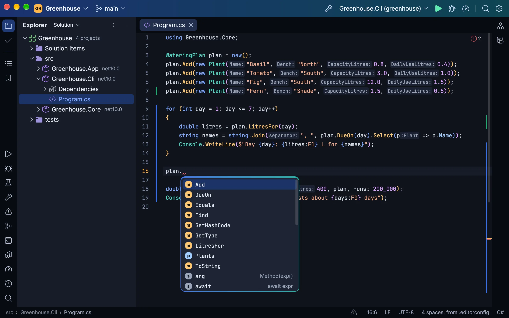
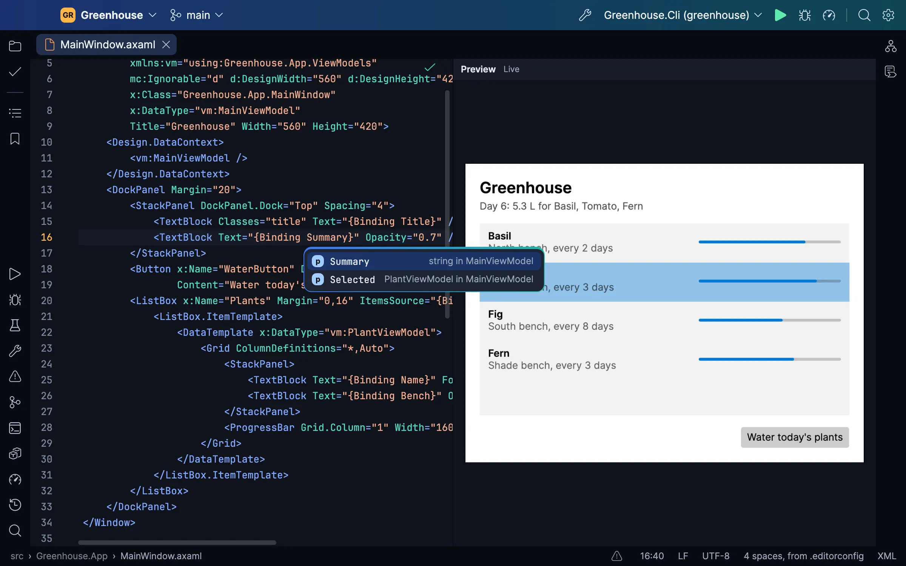
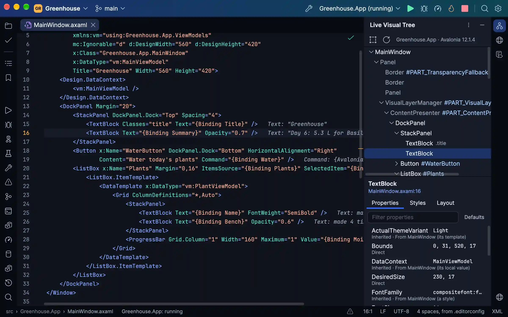
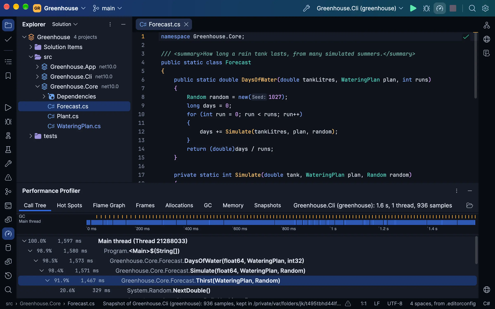
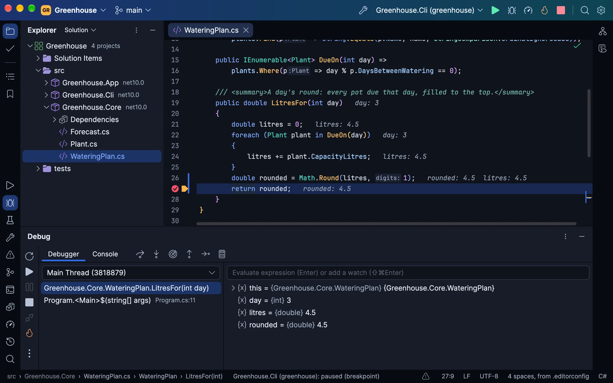
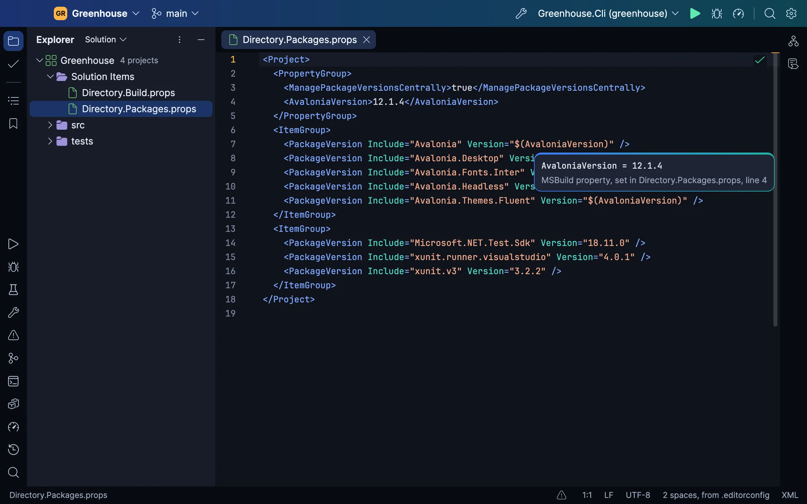
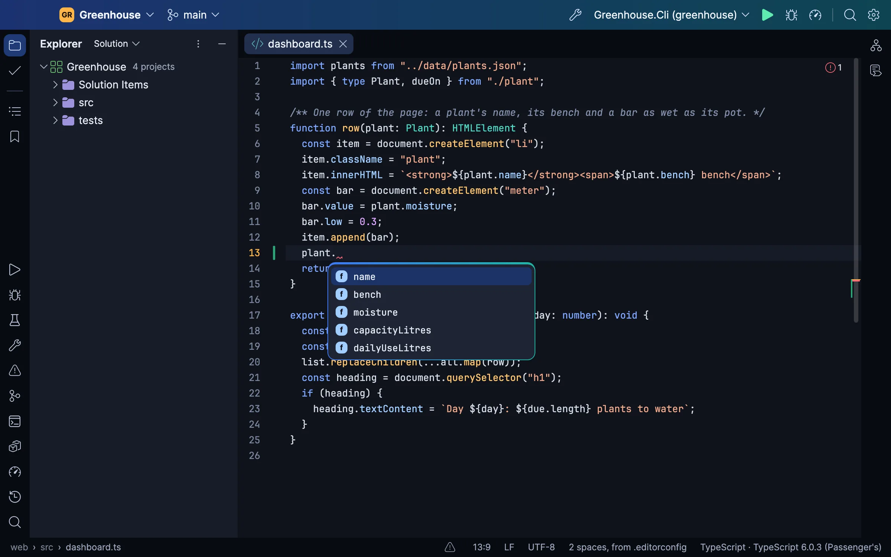
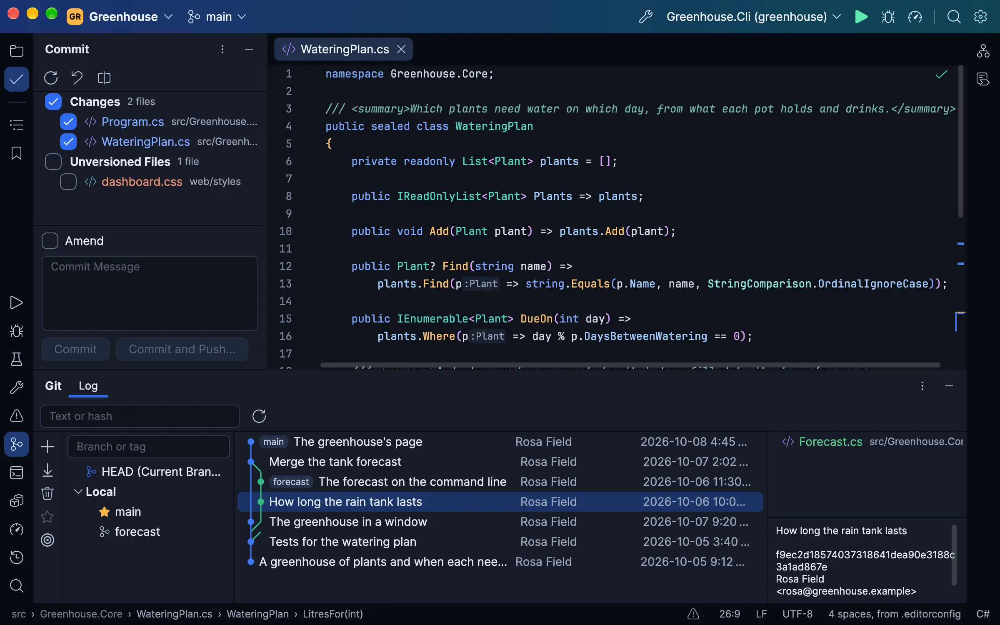
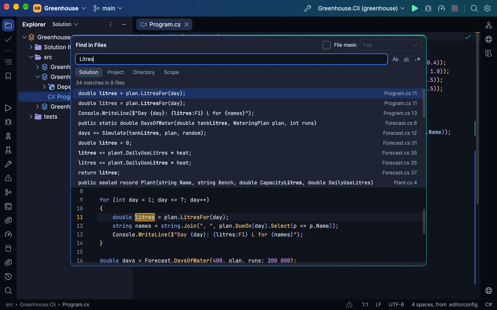
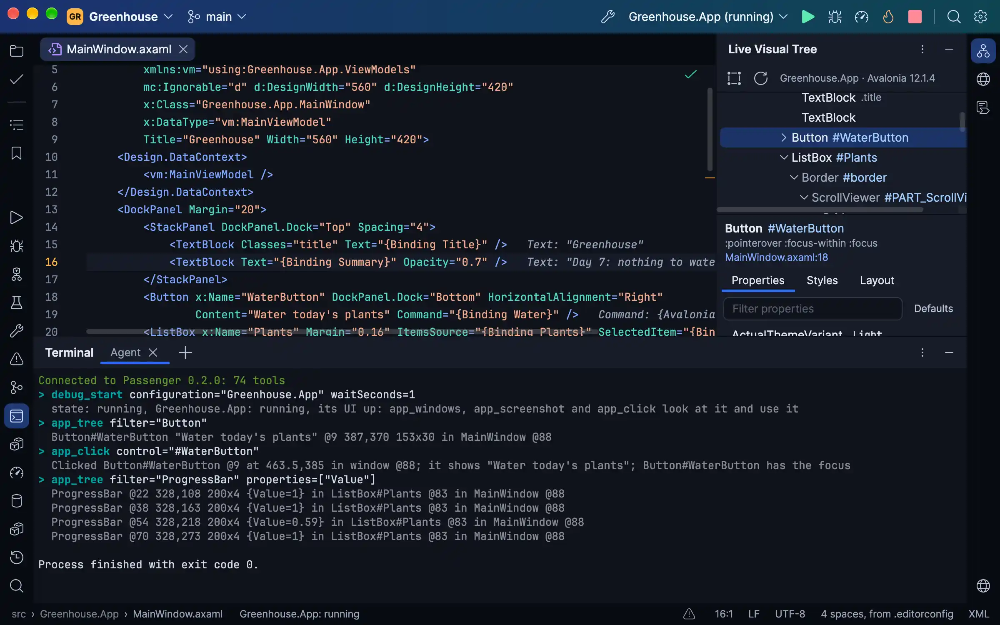

# Passenger

An IDE for C# and modern .NET, written in C# with Avalonia, free and open source under MIT. Windows and macOS first,
with builds for Linux ([how to install them](https://passenger-ide.net/linux)).

<p align="center">
  <a href="https://passenger-ide.net">Website</a> •
  <a href="https://passenger-ide.net/#download">Download</a> •
  <a href="#what-it-does">What it does</a> •
  <a href="#your-coding-agent-using-the-ide-as-you-do">Your coding agent</a> •
  <a href="#building">Building</a> •
  <a href="CONTRIBUTING.md">Contributing</a>
</p>

<picture>
  <source media="(prefers-color-scheme: light)" srcset="site/images/editor-light.webp">
  
</picture>

Passenger edits, builds, runs, tests, debugs and profiles C# and .NET. Much of what it includes usually takes a paid
IDE or a paid add-on; in Passenger it is part of the IDE, free and open source under MIT, for work and personal
projects alike:

- **XAML tooling for Avalonia and WPF.** Completion and checks for both, a preview as you type (WPF's on Windows), the
  running app's Live Visual Tree, failed bindings listed with fixes, and in Avalonia, binding values after the XAML's
  lines and breakpoints in the XAML. More XAML tooling than you'll find in other .NET IDEs.
- **Performance and memory profiling.** A timeline, call tree, hot spots and flame graph, from a program's start or
  attached to one running; heap snapshots with retained sizes and paths to roots, compared to show new, dead and
  survived objects. Usually a paid add-on.
- **A debugger of its own, with Hot Reload.** The values methods returned, Smart Step Into, exception breakpoints, data
  breakpoints on Windows x64, decompiled code for libraries without symbols, attaching on a Mac with nothing to set
  up, and your edits put in the program while it is paused or running.
- **An IDE your agent can drive.** Passenger is an MCP server. A coding agent asks it about the code, builds, tests,
  debugs and profiles through it, and tries out the Avalonia or WPF app it is building: pictures of its windows, its
  controls, clicks and typing. On your own window it asks you first.
- **The rest of a full IDE:** a three-way merge for Git's conflicts, Local History, NuGet with vulnerable versions
  marked, four test frameworks and a terminal of its own.

What comes next is in the [milestones](https://github.com/Zaneris/passenger/milestones), the release in progress among
them. The pictures here are of a sample project committed to this repository, in your system's light or dark.

## What it does

### Avalonia and WPF

`.axaml` files get the help C# gets, from the project's own assemblies and Avalonia's own compiler and previewer:
completion of controls, properties, values, resources, selectors and binding paths checked against `x:DataType`, the
XAML compiler's errors on their lines, Go to Declaration into C#, rename of `x:Name`, Reformat Code, Extract Resource
and Extract Style, and a missing property, command or converter made from where it is used. XAML Preview draws the
file beside it, following each edit.

<picture>
  <source media="(prefers-color-scheme: light)" srcset="site/images/xaml-light.webp">
  
</picture>

Debug an Avalonia app and the Live Visual Tree shows its controls as they are, each property with where its value came
from and each style with why it applies or not, and the XAML shows each binding's value after its line. A failed
binding is a console line linked to its XAML and a row in Problems with a fix where there is one, and can stop the
debugger like an exception. Breakpoints go on an element, one of its attributes, or a property's next change. The
profiler charts an Avalonia app's frames and their layout by control, and a failed Avalonia.Headless test (xUnit v3)
carries a picture of each window as it was.

<picture>
  <source media="(prefers-color-scheme: light)" srcset="site/images/live-tree-light.webp">
  
</picture>

WPF projects get the same XAML help on every system, with binding paths checked against the design-time data context.
On Windows, XAML Preview draws WPF files, and while a WPF app is debugged the Live Visual Tree shows where each value
came from and which styles and triggers set it, Break When Value Changes stops on a property's next change, and failed
bindings show and can stop the debugger. Elsewhere a WPF or Windows Forms project builds for its code help and says it
runs only on Windows.

### Profiling

A sampling profiler over the runtime's EventPipe, from a program's first instruction or attached to one already
running: its call tree, hot spots, flame graph, allocations and garbage collections, narrowed to any stretch of the
timeline. A memory snapshot counts the heap by type, with each object's retained size, and shows the shortest paths
that keep it alive; two snapshots compared say which objects are new, which died and which survived.

<picture>
  <source media="(prefers-color-scheme: light)" srcset="site/images/profiler-light.webp">
  
</picture>

### Debugging

Passenger's own debugger (started from SharpDbg and ICorDebugSharp, over ICorDebug): breakpoints with conditions, hit
counts and log messages, exception breakpoints, stepping through async code, Smart Step Into, the values methods
returned, Run to Cursor and Set Next Statement, the call stack and threads, variables you can open and set, watches and
evaluation, and the values each line used drawn after it. A frame in a library without symbols shows its code,
decompiled. Data breakpoints work on Windows x64, where the runtime supports them.

Edit the code while debugging and Hot Reload puts it in the program, paused or running. An edit it can't apply is
listed in Problems with why, and by default the program restarts to take it. Without the debugger, Hot Reload runs
under `dotnet watch`.

<picture>
  <source media="(prefers-color-scheme: light)" srcset="site/images/debugger-light.webp">
  
</picture>

Run | Attach to Process (Ctrl+Alt+P, ⌘⌥P on a Mac) lists the .NET programs running on your machine, by executable,
process ID, user and command line, and debugs the one you choose as if Passenger had started it. Run | Detach lets it
go again, running on, and Reattach to Process (Alt+Shift+P) attaches to the last one again, even started anew. It
lists programs on .NET Core 3.0 and later, whose runtime opens pipes for a debugger; .NET Framework and Mono are not
Passenger's.

On a Mac this needs no setup: no Developer Tools access, no debugger entitlement, no signing of yours or the
program's. The debugger reaches a program's runtime through those pipes, in your temporary folder, not through the
task port macOS guards, so a program you started in a terminal, one signed under the hardened runtime, and Passenger
itself attach as a program the debugger starts does. The program has to run as you, with your temporary folder
(`TMPDIR`), and with its diagnostics on (`DOTNET_EnableDiagnostics` not set to 0).

### The editor and C#

A text control of its own over an immutable rope: multiple carets, folding, soft wrap, Extend Selection, live, postfix
and surround templates, inlay hints, the symbol at the caret lit through the file, and splits and tabs in windows of
their own. A key costs what it changed, not the file's size. Coming from Rider? Passenger ships Rider's Visual Studio
keymap (Visual Studio OSX on a Mac), chords included, and behaves as a Rider user expects. Coming from VS Code? Settings,
Keymap switches to Rider's VS Code keymap.

C# comes from Roslyn: its parser colours as you type, then the language server gives diagnostics, completion, hovers,
signature help, quick fixes and refactorings (Change Signature, Extract Interface, Move, Pull Members Up, Safe Delete
and more), a rename that renames the type's file, Go to Declaration, Implementation and Base Symbols, Find Usages, call
and type hierarchies and decompiled library sources. Problems lists the whole solution's without a build. Razor and
Blazor files get C# and HTML help together.

Twelve looks of its own, each dark and light: Passenger, the default, in the app icon's blue; Harbour, warmer and
rounder, the icon's teal on linen by day and a warm charcoal by night; and Sorbet, Nocturne, Saffron, Bonbon, Ledger,
Slate, Orbit, Nightjar, Moss and Phosphor, each checked for contrast in both.

### Project files and the web languages

In a `.csproj`, `.props` or `.targets`: completion of elements, properties, items and their values, and of package ids
and versions from your feeds (under central package management, the version goes to `Directory.Packages.props`), a
property's evaluated value and where it was set, Go to Declaration into the SDK's own files, and the evaluation's
errors on their lines.

<picture>
  <source media="(prefers-color-scheme: light)" srcset="site/images/project-files-light.webp">
  
</picture>

JavaScript, TypeScript, HTML, CSS, SCSS, Less and JSON go through their language servers on Node.js: completion,
checks, navigation and formatting, TypeScript on the project's own version, JSON against its schema, ESLint's problems
and fixes as you type, and the project's own Prettier on Reformat Code and on save.

<picture>
  <source media="(prefers-color-scheme: light)" srcset="site/images/web-light.webp">
  
</picture>

### Git

The Commit window with its changes, the log with its branch graph and branches, side-by-side diffs with the changed
words marked, blame, change bars in the gutter that roll a change back, the history of a file, a folder or a
selection, stashes, push, pull and fetch, and conflicts resolved in a three-way merge.

<picture>
  <source media="(prefers-color-scheme: light)" srcset="site/images/git-light.webp">
  
</picture>

### Search

Search Everywhere, Go to File, Go to Symbol and Find Action, Find and Replace in Files across the solution, a project,
a folder or a scope with a file mask and a preview, Find Usages in a window of its own, Recent Files and Recent
Locations, bookmarks and File Structure.

<picture>
  <source media="(prefers-color-scheme: light)" srcset="site/images/find-in-files-light.webp">
  
</picture>

### And the rest

- **Build and run:** a Solution view of the projects as MSBuild evaluates them, builds with their errors in Problems,
  run configurations from your launch profiles, and consoles whose stack frames link to their lines.
- **Unit tests:** xUnit, NUnit, MSTest and TUnit, through VSTest or Microsoft.Testing.Platform, found from the code
  before any build, with run marks in the gutter, grouping and filters, and any test debugged.
- **NuGet:** the feeds your `nuget.config` names, packages installed, updated and removed per project, central package
  management, and vulnerable versions marked with the lowest that fixes them.
- **Terminal:** an emulator of its own with a shell per tab; a console program can run and be debugged in it.
- **Local History**, tool windows docked or floating, a window per solution, New Solution from `dotnet new`'s
  templates, and updates that install themselves on Windows and macOS.

## Your coding agent, using the IDE as you do

<picture>
  <source media="(prefers-color-scheme: light)" srcset="site/images/agent-light.webp">
  
</picture>

Connect a coding agent such as Claude Code, Codex or OpenCode to Passenger and it works through the IDE, not just your
files. It finds where things are declared and used, reads the warnings, and renames, fixes and formats code as the IDE
does, in C#, Razor, XAML, the web languages and project files alike. It builds, runs and tests, sets breakpoints, steps,
reads and changes variables, applies Hot Reload and profiles a run. It searches and replaces across files, commits,
resolves conflicts, adds packages, types into the terminal and looks at the window. When the program is an Avalonia app,
or a WPF app on Windows, it sees and drives the app as a person testing it would, without taking your focus or your
pointer.

There are two ways in, each a flag on Passenger's own executable:

- **`--mcp-attach`** joins the window you have open over the folder the agent works in (`--mcp-attach PID` chooses one
  Passenger's windows), so its breakpoints and stops show in your editor and its runs in your Run window. Set it up
  before Passenger is even running: the agent has its tools from the start, and its first call opens the folder in
  Passenger, starting it if need be. It never joins a window on another folder. The window asks you before it lets an
  agent in (Allow, Don't allow, or Always for this folder), unless you have turned on Settings | MCP Server | Enable
  MCP Server; it is reached through a socket in your own user's folder, and the first time an agent uses a tool that
  changes anything, or opens another folder in your window, it asks you again. While a question waits, the window comes
  forward (on a Mac the Dock icon bounces), the status bar says which agent waits and on what, and the agent is told so;
  an answer not given within two minutes comes back to the agent as nobody having answered, and its next call asks again.
- **`--mcp FOLDER`** starts a Passenger of the agent's own with no window, over a folder or solution, for work it does
  alone. It asks nothing, so it suits an agent you leave to work while you are away.

A call that takes a while (a build, a test run, a debug session waiting for a stop) tells the agent what it is doing
every 10 seconds when the agent asks for progress, so an agent that gives up on a call it hears nothing of waits on.
With Settings | Diagnostics | Trace protocol messages on, `mcp.log` in the logs folder has each agent's call, what it
waited on and for how long.

The quickest way in is Passenger's own Settings | MCP Server: it shows each agent's setup below with this copy's own
path filled in, each with a Copy button, and lists the folders agents join unasked, each one to take back.

Passenger is `/Applications/Passenger.app/Contents/MacOS/Passenger` on a Mac,
`%LOCALAPPDATA%\PassengerIDE\current\Passenger.exe` on Windows, and `~/.local/bin/passenger` on Linux
(`/usr/local/bin/passenger` when installed for everyone). A repository's `.mcp.json` gives it to everyone who works
there with Claude Code:

```json
{
  "mcpServers": {
    "passenger": {
      "command": "/Applications/Passenger.app/Contents/MacOS/Passenger",
      "args": ["--mcp-attach"]
    }
  }
}
```

Or add it for yourself:

```sh
# Claude Code
claude mcp add passenger -- /Applications/Passenger.app/Contents/MacOS/Passenger --mcp-attach
# Codex CLI
codex mcp add passenger -- /Applications/Passenger.app/Contents/MacOS/Passenger --mcp-attach
```

Claude Desktop takes the same `mcpServers` entry in Settings | Developer | Edit Config, with the folder to work in after
`--mcp-attach`, since it starts its servers in no folder of yours; the Codex desktop app takes it in Settings | MCP
servers | Add server (STDIO, with the same command and argument). Any other agent that can add an MCP server connects
the same way.

OpenCode takes it in `opencode.json`, at your project's root or in `~/.config/opencode/` for every project, with a
timeout of 10 minutes on a call:

```json
{
  "mcp": {
    "passenger": {
      "type": "local",
      "command": ["/Applications/Passenger.app/Contents/MacOS/Passenger", "--mcp-attach"],
      "enabled": true,
      "timeout": 600000
    }
  }
}
```

OpenCode 2 lists its servers under `mcp.servers`. Turn Code Mode off for Passenger, so OpenCode calls its tools
itself (Code Mode's permission prompts can leave a call waiting), and give a call 30 minutes rather than 12 hours (OpenCode 2
counts a call's whole time whatever progress it hears, so a long build or test run needs the room):

```json
{
  "mcp": {
    "servers": {
      "passenger": {
        "type": "local",
        "command": ["/Applications/Passenger.app/Contents/MacOS/Passenger", "--mcp-attach"],
        "codemode": false,
        "timeout": { "execution": 1800000 }
      }
    }
  }
}
```

This repository's own [`.mcp.json`](.mcp.json) runs [`tools/mcp.sh`](tools/mcp.sh), the script `just mcp` runs too:
the last Debug build with `--mcp` over this folder, run from a clone of the build so rebuilding Passenger never changes
the files under the agent's IDE.

## Building

Building needs the .NET 11 SDK (11.0.100-rc.2 or later, as [`global.json`](global.json) asks, until .NET 11 ships in
November 2026) and [just](https://github.com/casey/just). The tests need more:

- **the .NET 10 SDK** beside it, since the programs the debugger's tests debug ([`tests/Debuggees`](tests/Debuggees))
  and most projects the tests write run on .NET 10;
- **Git**, which the IDE runs for its Git features and the tests for theirs;
- on Linux, **the X11 and fontconfig libraries** [Passenger's Linux page](https://passenger-ide.net/linux) names, which
  the headless tests draw their text with too;
- **Node.js**, for the web languages' tests, which skip without it, saying why;
- **a container engine running Linux containers** (Docker Desktop, Docker Engine, Colima, OrbStack), for the container
  tests, which skip without one, saying why.

**Python 3** runs the recipes that write or check generated files (`just icons`, `just file-icons`, `just themes`,
`just unicode-widths`, `just notices`, `just test-times`) and some of the macOS ones (`just app-icon`,
`just package-mac`, `just site-shots`). To use what you build, Passenger needs what a release needs: a .NET SDK 10 or
later, Git, and Node.js for the web languages.

```sh
just build                 # Debug build; warnings are errors
just run [PATH]            # run it on a folder or solution (--theme dark|light, --look passenger, harbour, sorbet…)
just test [FILTER]         # every test, the IDE driven whole on Avalonia's headless platform, or those matching;
                           # the results in artifacts/test-results
just screenshot shell.png  # draw the main window to a PNG off-screen (--size 1600x1000 --scale 2)
just mcp [FOLDER]          # Passenger as an MCP server over a folder, from a clone of the last build
just publish osx-arm64     # a self-contained Release build (win-x64, win-arm64, linux-x64, linux-arm64 too)
just package-mac           # the macOS disk image, Apple Silicon; signed with PASSENGER_SIGN_IDENTITY, else ad hoc
just package-win win-x64   # the Windows installer (or win-arm64), unsigned unless tools/package-win.sh's variables sign it
just package-linux         # the Linux archive with its install.sh (linux-x64, or linux-arm64), as site/linux.html uses it
just container-tools       # the tools Passenger debugs and profiles with inside a Linux container, where a build finds them
just notices               # fail naming any package THIRD_PARTY_NOTICES.md does not name
```

Every recipe sets `AVALONIA_TELEMETRY_OPTOUT=1`. Avalonia's build task (Avalonia.BuildServices, which every Avalonia
package brings) otherwise sends AvaloniaUI a record of each build: a machine id it keeps, hashes of the machine and
user names and of the project's name, the system, the IDE and the CI it ran under. It reads its opt-out only from the
environment, so set the variable yourself for a build outside `just` (`dotnet build`, an IDE's).

Packages come only from nuget.org (`nuget.config`), at the versions and content each project's `packages.lock.json`
pins, and on Windows and Linux only as nuget.org signed them (NuGet checks no signatures on macOS). A restore on your
machine updates a lock file when you add or change a package; commit it with the change, since CI restores only what
the lock files name.

The website is [`site/`](site), plain HTML and CSS deployed to [passenger-ide.net](https://passenger-ide.net) when the
Site workflow is run by hand.

## Contributing

[`CONTRIBUTING.md`](CONTRIBUTING.md) says how to report a bug, propose a change and open a pull request, and what
working on Passenger needs.

## Licence

MIT (`LICENSE`). Third-party code and assets keep their own licences, listed in `THIRD_PARTY_NOTICES.md`.
