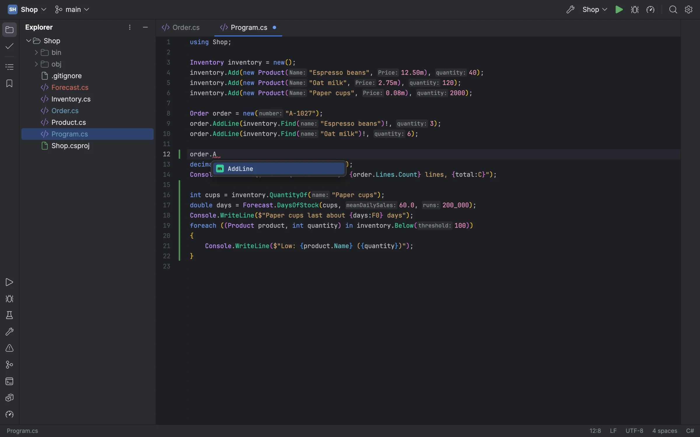
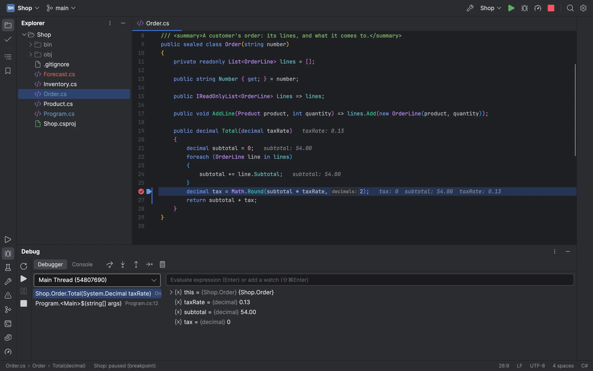
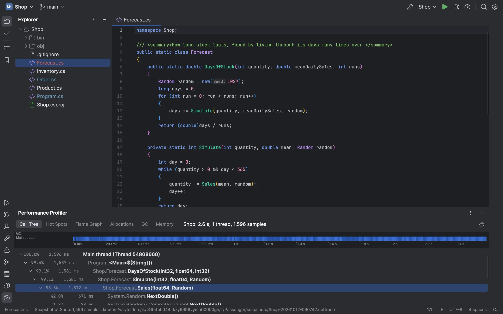
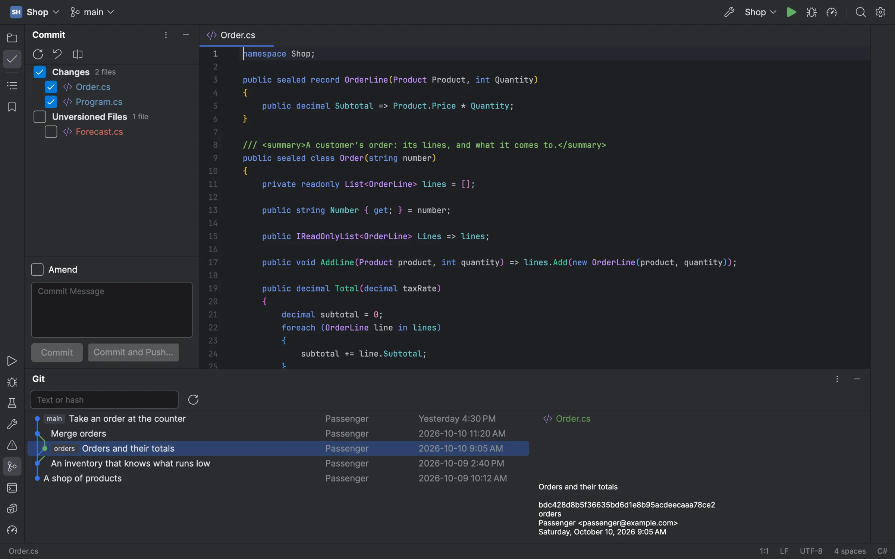
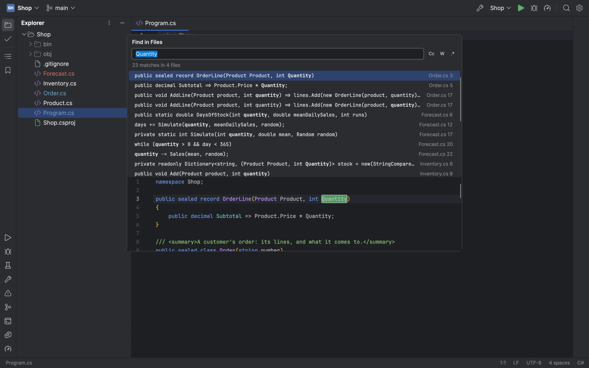

# Passenger

An IDE for C# and modern .NET, inspired by JetBrains Rider, written in C# with Avalonia. Windows and macOS first.

**[passenger-ide.net](https://passenger-ide.net)**: what it does, downloads, and how to connect a coding agent.



It's early, but it's a working IDE: an editor of its own (a rope, multiple carets, code folding, Rider's Visual Studio
keymaps), Roslyn's colours, diagnostics, completion, hovers, fixes, refactorings, rename and navigation through the
Roslyn language server, a Solution view, building, running and unit tests, a debugger and a profiler of its own, Git,
NuGet and a terminal. An MCP server gives an agent the same IDE. The [MVP milestone](https://github.com/Zaneris/passenger/milestone/1)
lists what comes next.

The pictures here are of a small sample shop, drawn by Passenger itself on Avalonia's headless platform.

### Debugging

Passenger's own debugger (started from SharpDbg, over ICorDebug): breakpoints with conditions, hit counts and log
messages, stepping, Run to Cursor and Set Next Statement, the call stack and threads, variables you can open and set,
watches and evaluation, and the values each line used drawn after it, as Rider does.



### Profiling

A sampling profiler like dotTrace's, over the runtime's EventPipe: a configuration profiled from its first
instruction, then its call tree, hot spots, flame graph, allocations and garbage collections, narrowed to any stretch
of the timeline. A memory snapshot counts a running program's heap by type.



### Git

The Commit window with its changes and unversioned files, the log with its branch graph and each commit's files,
diffs, blame annotations, change bars in the gutter that roll back a hunk, branches, push, pull and fetch.



### Search

Search Everywhere, Go to File, Go to Symbol and Find Action, Find and Replace in Files with a preview, Recent Files,
bookmarks, and Extend Selection through the syntax tree.



## Building

You need the .NET 11 SDK (the release candidate works until it ships in November 2026) and
[just](https://github.com/casey/just).

```sh
just build                 # Debug build; warnings are errors
just run                   # run it
just screenshot shell.png  # draw the main window to a PNG off-screen (--size 1600x1000 --scale 2)
just publish osx-arm64     # a self-contained Release build (osx-x64, win-x64, win-arm64 too)
just package-mac           # the macOS disk image (or osx-x64); signed with PASSENGER_SIGN_IDENTITY, else ad hoc
just package-win win-x64   # the Windows installer (or win-arm64), unsigned unless tools/package-win.sh's variables sign it
just notices               # fail naming any package THIRD_PARTY_NOTICES.md does not name
```

Every recipe sets `AVALONIA_TELEMETRY_OPTOUT=1`. Avalonia's build task (Avalonia.BuildServices, which every Avalonia
package brings) otherwise sends AvaloniaUI a record of each build: a machine id it keeps, hashes of the machine and
user names and of the project's name, the system, the IDE and the CI it ran under. It reads its opt-out only from the
environment, so set the variable yourself for a build outside `just` (`dotnet build`, an IDE's).

Packages come only from nuget.org (`nuget.config`), at the versions and content each project's `packages.lock.json`
pins, and on Windows and Linux only as nuget.org signed them (NuGet checks no signatures on macOS). A restore on your
machine updates a lock file when you add or change a package; commit it with the change, since CI restores only what
the lock files name.

## For agents

Passenger is a Model Context Protocol server, so a coding agent can use what the IDE knows: diagnostics, symbols,
definitions, usages, renames and fixes from Roslyn, builds and runs, unit tests, the debugger (breakpoints, stepping,
evaluation, the stopped program's variables), Git (status, diffs of unsaved text, commits, the log, branches), NuGet,
the IDE's own terminal, and screenshots of the window. Two ways to connect, shown here for Claude Code:

```sh
# Passenger with no window, its own IDE over a folder or solution
claude mcp add passenger -- /path/to/Passenger --mcp /path/to/solution
# the Passenger window you have open: the agent's breakpoints and stops show in it
claude mcp add passenger -- /path/to/Passenger --mcp-attach
```

A window lets agents in only once you turn on Settings | MCP Server | Enable MCP Server (never when started with
`--no-mcp`): it then listens on a socket of its own that only you can reach, and `--mcp-attach` joins the window whose
folder holds the agent's working directory. An agent asks before its first use of each tool that changes something
(an edit, a build or run, a commit, a terminal command). In this repository, `.mcp.json` runs `just mcp`, which starts
the last build over this folder.

## Licence

MIT (`LICENSE`). Third-party code and assets keep their own licences, listed in `THIRD_PARTY_NOTICES.md`.
